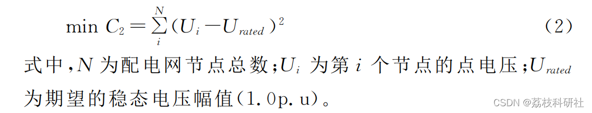
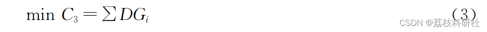
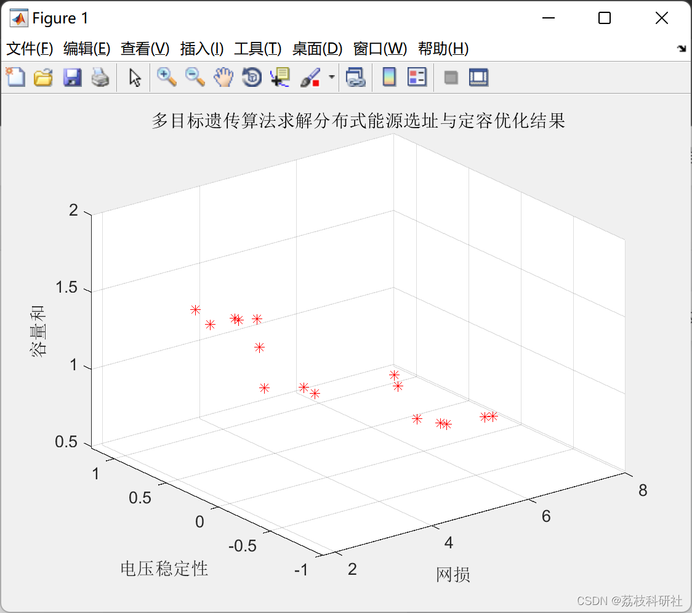
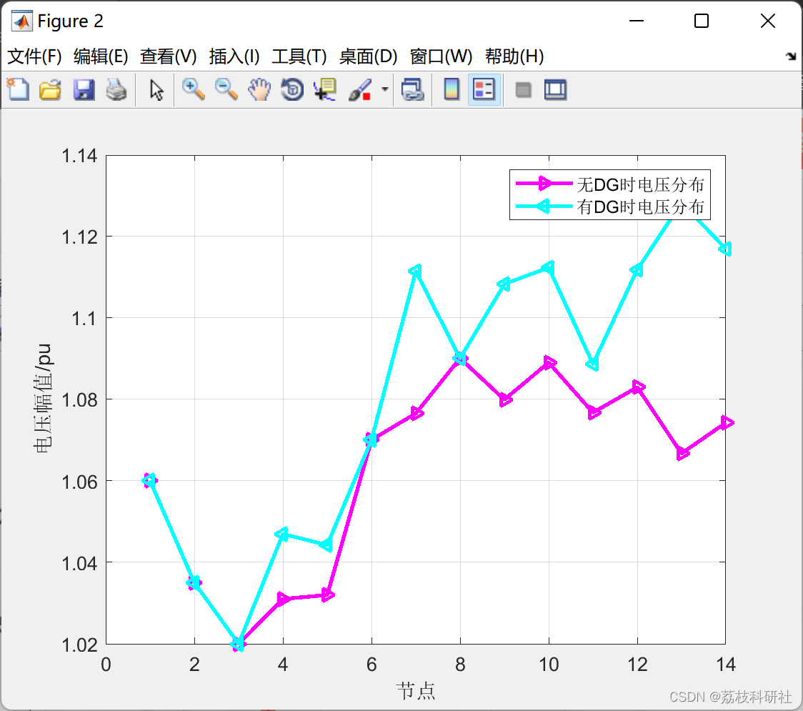

# [Location and Capacity of Distributed Energy]Solving Location and Capacity of Distributed Energy Based on Non-Dominated Sort Multi-Objective Genetic Optimization Algorithm (Matlab Code)

Editor
This article adopts a different algorithm to solve, based on the non-dominated sorting multi-objective genetic optimization algorithm to solve the location and capacity selection of distributed energy. 
The integration of renewable energy distributed generation technology with the large power grid is widely recognized as an approach to energy conservation, emission reduction, green environmental protection, and safe and reliable power system operation, representing the direction for power development. Distributed Generation (DG) refers to small modular power generation units that are distributed in user areas and compatible with the environment, with power generation ranging from several kilowatts to several megawatts.
Currently, most distributed generation systems operate in parallel with the distribution network. After DG is connected to the grid, it can influence the flow distribution of the distribution network, which can then be optimized to alleviate the pressure on the distribution network's transmission and distribution voltage. However, due to the significant randomness in DG's connection and disconnection, and its output power stability being easily affected by the environment, improper DG integration can have numerous negative impacts on the power grid, such as affecting the stability of the distribution network and voltage quality, generating harmonics, etc. The magnitude of these impacts is greatly related to the capacity and location of DG, making the location and capacity selection of DG a key issue to consider during the DG planning stage.
Due to the single-minded optimization objectives of planning, traditional planning methods struggle to effectively address this issue. In recent years, multi-objective optimization that takes into account factors such as voltage, current quality, and environmental conditions has rapidly developed. However, the lack of unified dimensions significantly increases the complexity of the problem, presenting new challenges for multi-objective optimization. This paper, building on the standard particle swarm optimization algorithm, addresses the location and capacity selection issues in distribution networks with Distributed Generation (DG). A mathematical model is established, which includes objective functions such as power loss, voltage quality, and total DG capacity. Fuzzy theory is employed to transform the multi-objective optimization model into a single-objective optimization model based on fuzzy membership degrees. The non-dominated sorting multi-objective genetic algorithm is then utilized for optimization. Simulations on the IEEE14 standard node test system demonstrate the practicality of a DG configuration scheme.
1.1 Power loss: The power loss in the process of transmitting electricity from the generation end to the load end is unavoidable, but it can be minimized by reducing active power loss and effectively configuring Distributed Generation (DG) in the distribution network. This can effectively reduce active power loss, improve the utilization rate of electricity generation, and save energy. The objective function for minimizing active power loss is optimally expressed as follows:
The quality of pressure is affected by the voltage stability of the distribution system. The voltage quality is described by the variance of the voltage based on the expected voltage. The optimal mathematical expression of the objective function based on voltage quality is:
Editor
1.3 The total capacity of DG must not only consider the economic effects of improving the power grid, but also take into account the costs associated with the installation, operation, and maintenance of DG. This article does not involve economic models, only considers the total capacity of DG connected to the distribution network. The optimal mathematical expression of the objective function based on the total capacity of DG is:
Editor
📚2 Running Results Editing
Editor
🌈3 Matlab code implementation:
% Jacobian matrix
J=[jpt jpv; jqt jqv];  
X = (inv(J))*M;% deviation
%% Phase deviation
dTh = X(1:nbus-1);
%% Voltage deviation
dV = X(nbus:end);
[e1,d1,n1]=eig(JR); % Calculate the eigenvalues and eigenvectors of matrix A using the function eig(A)[V,D,W] = eig(A), [V,D,W] = eig(A) returns full matrix W such that W'A = DW'.
%diag(A), if A is a matrix, the function diag generates the diagonal of the extracted matrix; if a is a vector, the function diag generates a matrix with a diagonal of a.
%% Target 2 Voltage Stability
f2val=max(1./diag((d1)))*max(abs(dQ)); % Target 2, stability
del(2:nbus) = dTh + del(2:nbus);
k = 1;
for i = 2:nbus
    if type(i) == 3
        V(i) = dV(k) + V(i);
        k = k+1;
    end
end
%% Target 2 and Target 3
tval=sum(1./diag((d1)));
po_val=flow_cal(nbus,V,del,BMva);
f1val=sum(po_val); % Each branch network loss and
f3val=sum(datain(5:8)); % DG capacity and
fout=[f1val; f2val; f3val];
%% Jacobian matrix
J=[jpt jpv; jqt jqv];
X = (inv(J))*M; % Deviation
%% Phase deviation
dTh = X(1:nbus-1);
%% Voltage deviation
dV = X(nbus:end);  
[e1, d1, n1] = eig(JR); % Calculate the eigenvalues and eigenvectors of matrix A using the function eig(A)[V, D, W] = eig(A), [V, D, W] = eig(A) returns full matrix W such that W'A = DW'.  
%diag(A), if A is a matrix, the function diag generates the diagonal of the extracted matrix; if a is a vector, the function diag generates a matrix with a diagonal of a.  
% Target 2 Voltage Stability  
f2val = max(1./diag((d1))) * max(abs(dQ)); % Target 2, Stability  
del(2:nbus) = dTh + del(2:nbus);  
k = 1;  
for i = 2:nbus  
    if type(i) == 3  
        V(i) = dV(k) + V(i);  
        k = k+1;  
    end  
end  
% Target 2 and Target 3  
tval = sum(1./diag((d1)));  
po_val = flow_cal(nbus, V, del, BMva);  
f1val = sum(po_val); % Total losses across branches  
f3val = sum(datain(5:8)); % DG capacity and  
fout = [f1val; f2val; f3val];  
🎉4 References  
[2] Feng Yuanyuan. Research on Distributed Generation Site Selection and Capacity Determination Based on Multi-Objective Planning [D]. North China Electric Power University, 2015.  
[3] Yang Zhijun. Distributed Power Source Site Selection and Capacity Determination Based on Particle Swarm Optimization [D]. Taiyuan University of Science and Technology, 2019.DOI:10.27721/d.cnki.gyzjc.2019.000065.
​  

## Images

<!-- PAYMENT_BLOCK -->

## Get this dataset

- Payment link (Stripe): [Buy now](https://buy.stripe.com/3cs8yP7sY87d0vu9AB)
- Payment QR code: 

<!-- /PAYMENT_BLOCK -->
